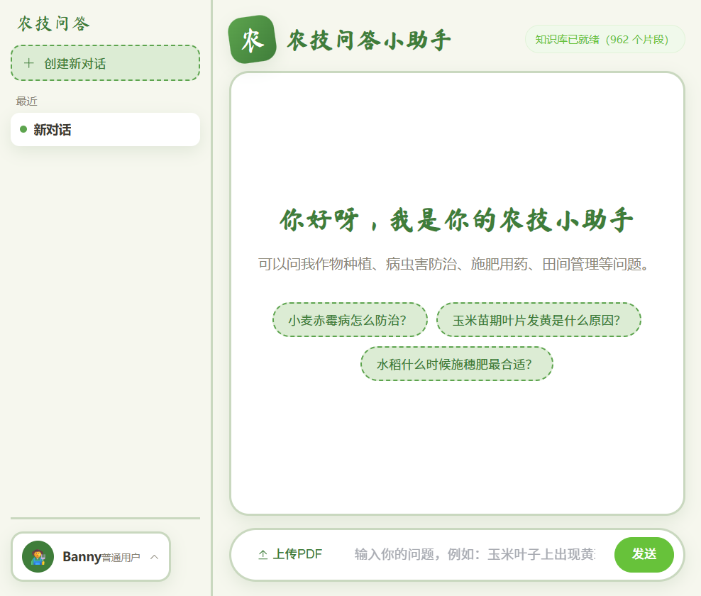
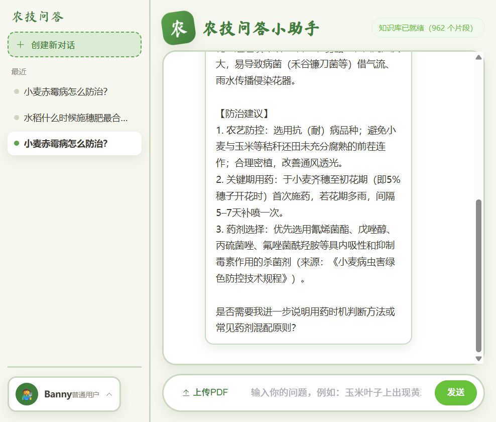
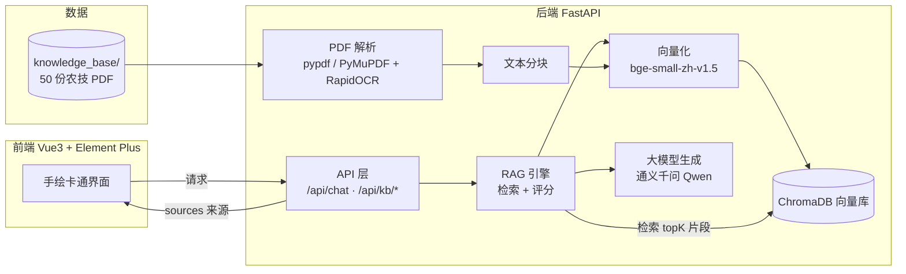

<div align="center">

# 农作物农技问答 RAG 智能系统

基于本地农技 PDF 知识库 + **RAG（检索增强生成）** 的多用户智能客服系统。
回答严格依据知识库 PDF 原文（支持扫描件 OCR），自动标注来源，并内置转人工与安全边界规则。

[](https://www.python.org/)
[](https://fastapi.tiangolo.com/)
[](https://vuejs.org/)
[](https://element-plus.org/)
[]()

</div>

---

## 项目亮点

- **严谨可信的问答**：只基于知识库 PDF 原文作答，每条回答内联标注“来源”文档，不编造、不臆测。
- **扫描件 OCR 兜底**：内置 RapidOCR 中文识别，文字型扫描 PDF 也能建档入库。
- **本地私有化部署**：向量库（ChromaDB）存本地，除调用大模型外无外部依赖，数据不出域。
- **多用户体系**：预设 / 新建 / 登录 / 退出 / 注销账号，会话按用户隔离并本地持久化。
- **持续扩充知识**：支持页面直接“上传 PDF”增量建档，也可命令行批量扫描。
- **手绘卡通风格 UI**：Vue3 + Element Plus，贴近农业用户的亲和界面。

---

## 界面预览

**首页 · 欢迎区与快捷问题**



**问答演示 · 结构化回答与来源标注**



---

## 系统架构



**问答流程**：用户提问 → 问题向量化 → 在向量库中检索最相关片段（相似度阈值过滤）→ 注入系统客服规则与大模型 → 生成结构化回答并附来源。

---

## 技术栈

| 模块 | 技术 |
| --- | --- |
| 后端 | FastAPI + uvicorn + pydantic |
| PDF 解析 | pypdf / PyMuPDF + RapidOCR（扫描件回退） |
| 向量化 | sentence-transformers + bge-small-zh-v1.5（经 hf-mirror 镜像下载） |
| 向量库 | ChromaDB |
| 大模型 | 通义千问 Qwen（OpenAI 兼容接口，可换 DeepSeek） |
| 前端 | Vue3 + Vite + Element Plus + axios |

---

## 目录结构

```
农作物农技问答 RAG 智能ai/
├── ANALYSIS_MODELING_REPORT.md   # 问题分析与建模设计报告
├── VERIFICATION_REPORT.md        # 联调验证报告
├── requirements.txt              # 后端依赖
├── .env.example                  # 环境变量示例（勿提交 .env）
├── start-demo.bat / start-demo.ps1  # 一键启动脚本
├── docs/screenshots/             # 界面预览截图
├── knowledge_base/               # 农技 PDF 知识库（已随仓库提供，50 份）
├── backend/
│   ├── app/
│   │   ├── main.py               # FastAPI 入口
│   │   ├── config.py             # .env 配置
│   │   ├── system_prompt.py      # 客服系统提示词
│   │   ├── knowledge/            # PDF 解析（含 OCR 回退）+ 分块
│   │   ├── rag/                  # 向量化 + ChromaDB + RAG 引擎
│   │   ├── llm/                  # 大模型（OpenAI 兼容）客户端
│   │   └── api/routes.py         # 接口定义
│   └── scripts/ingest.py         # 命令行建档脚本
└── frontend/                     # Vue3 前端
```

> `data/` 为运行时生成的向量库目录，已被 `.gitignore` 忽略，不随仓库提交。

---

## 快速开始

### 方式一：一键启动（推荐）

环境满足“前置准备”后，双击运行仓库根目录的 `start-demo.bat`，脚本会自动启动后端 + 前端并打开浏览器。

```
双击 start-demo.bat
# 浏览器自动打开 http://localhost:5173
```

### 方式二：手动分步

**前置准备**

```powershell
# 后端依赖
cd backend
python -m pip install -r ..\requirements.txt

# 前端依赖
cd ..\frontend
npm install
```

**1. 配置 `.env`**

复制 `.env.example` 为 `.env`，并填写 API Key：

```
DEEPSEEK_API_KEY=你的密钥
DEEPSEEK_BASE_URL=https://dashscope.aliyuncs.com/compatible-mode/v1
DEEPSEEK_MODEL=qwen-plus
PDF_DIR=knowledge_base
```

API Key 兼容链（按顺序查找）：系统环境变量 `DEEPSEEK_API_KEY` → `DATAOPAI_API_KEY` → `API_KEY`；也可直接在 `.env` 的 `DEEPSEEK_API_KEY=` 填写。

> 安全提示：`.env` 已被 `.gitignore` 忽略，请勿将其提交到 Git 仓库。

**2. 启动后端**

```powershell
cd backend
python -m uvicorn app.main:app --host 127.0.0.1 --port 8000
# 或 python -m scripts.ingest 用于命令行首次建档
```

**3. 启动前端（新终端）**

```powershell
cd frontend
npm run dev
```

打开 http://localhost:5173 即可访问。

---

## 克隆到其他电脑使用

```powershell
git clone <仓库地址>
cd <仓库目录>
# 1. 配置 API 密钥：复制 .env.example 为 .env 并填写 DEEPSEEK_API_KEY
# 2. 一键启动，或按上面的“手动分步”启动后端与前端
```

知识库 PDF 已包含在 `knowledge_base/` 中。首次使用请在页面点击「扫描建档」建立向量索引（约需 20~25 分钟），之后即可正常问答。

---

## 建档与知识库管理

新增 / 更新 PDF 后，任选其一重建向量索引：

- 页面顶部点击「扫描建档」，或点击输入栏旁的「上传 PDF」直接增量上传；
- 或命令行：`cd backend && python -m scripts.ingest`
- `PDF_DIR` 支持指向本机任意文件夹（如 `F:\`），扫描建档时读取该目录下所有 PDF。

---

## 接口一览

| 接口 | 说明 |
| --- | --- |
| `GET /health` | 健康检查（含密钥与知识库就绪状态） |
| `GET /api/kb/status` | 知识库状态（文档数 / 分块数） |
| `POST /api/kb/ingest` | 扫描 `PDF_DIR` 重建索引 |
| `POST /api/kb/upload` | 上传 PDF 并自动建档 |
| `POST /api/chat` | `{question, files?}` → `{answer, sources, kb_ready}` |

接口文档（Swagger UI）：http://127.0.0.1:8000/docs

---

## 常见问题

- **问答返回「客服大脑未配置」**：未找到可用 API Key，请检查系统环境变量或 `.env` 后重启后端。
- **问答返回「知识库中没有这个问题的详细资料」**：该问题未在 PDF 中检索到相关内容（相似度低于阈值 0.35），系统按规则如实说明并建议转人工，不会编造。
- **扫描件 PDF 识别**：系统内置 RapidOCR 中文识别，文字型扫描件可正常建档；极端模糊件可能识别失败并记录告警。
- **首次启动下载模型**：会自动下载 bge 向量模型（约 100MB），默认经 hf-mirror 镜像，仅需一次。

---

## 已知限制

- OCR 对极端模糊 / 手写扫描件识别率有限；
- 回答质量取决于大模型与知识库内容，请以真实农技资料复核；
- 涉及农药用量的回答仅引用 PDF 原文，并提示以产品说明书和当地农技站指导为准。

---

## 免责声明

本系统生成的农技建议仅供学习参考，使用前请以权威部门发布的正式技术文件、产品说明书及当地农业技术部门的现场指导为准。